<picture><source media="(prefers-color-scheme: dark)" srcset="assets/hero-dark.svg"></picture>

<picture><source media="(prefers-color-scheme: dark)" srcset="assets/social-l-dark.svg"></picture><a href="https://discord.gg/hqE5wtCWHu"><picture><source media="(prefers-color-scheme: dark)" srcset="assets/social-1-dark.svg"></picture></a><a href="https://tiktok.com/@nimbus32.img"><picture><source media="(prefers-color-scheme: dark)" srcset="assets/social-2-dark.svg"></picture></a><picture><source media="(prefers-color-scheme: dark)" srcset="assets/social-r-dark.svg"></picture>

<picture><source media="(prefers-color-scheme: dark)" srcset="assets/about-dark.svg"></picture>

<picture><source media="(prefers-color-scheme: dark)" srcset="assets/stack-dark.svg"></picture>

<a href="https://github.com/shroomstech/curse-packages"><picture><source media="(prefers-color-scheme: dark)" srcset="assets/project-curse-packages-dark.svg"></picture></a>&nbsp;<a href="https://github.com/shroomstech/shroom"><picture><source media="(prefers-color-scheme: dark)" srcset="assets/project-shroom-dark.svg"></picture></a>

<a href="https://github.com/shroomstech/KelpOS"><picture><source media="(prefers-color-scheme: dark)" srcset="assets/project-kelpos-dark.svg"></picture></a>&nbsp;<a href="https://github.com/shroomstech/Alnix-wallpapers-dnftech"><picture><source media="(prefers-color-scheme: dark)" srcset="assets/project-alnix-wallpapers-dnftech-dark.svg"></picture></a>

<picture><source media="(prefers-color-scheme: dark)" srcset="assets/stats-dark.svg"></picture>

<picture><source media="(prefers-color-scheme: dark)" srcset="assets/streak-dark.svg"></picture>

<picture><source media="(prefers-color-scheme: dark)" srcset="assets/wave-dark.svg"></picture>

<a href="https://nimbusweb.duckdns.org"><picture><source media="(prefers-color-scheme: dark)" srcset="assets/button-1-dark.svg"></picture></a>&nbsp;&nbsp;<a href="https://github.com/shroomstech?tab=repositories"><picture><source media="(prefers-color-scheme: dark)" srcset="assets/button-2-dark.svg"></picture></a>

<a href="https://metawka.github.io/expressive-profile/?from=shroomstech"><picture><source media="(prefers-color-scheme: dark)" srcset="assets/credit-dark.svg"></picture></a>

